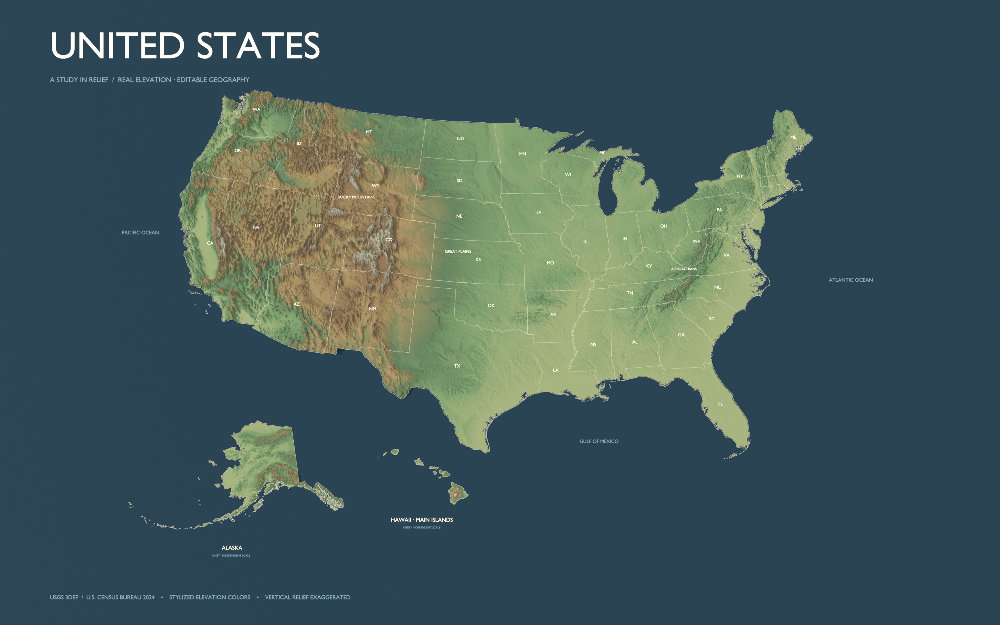
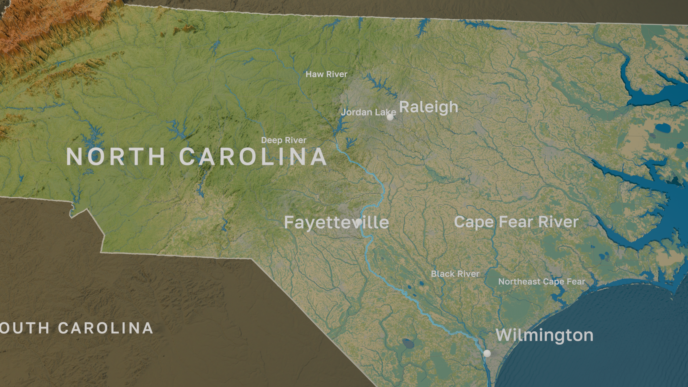

# Blender Map Workflow

A portable Made With Robots skill and reproducible GIS-to-Blender pipeline for another LLM to create editable relief maps. No standalone application, custom GUI, or required Blender add-on.

## Start here when opening this folder

Read the [first-use guide](blender-map-workflow/references/user-guide.md). It explains what to request, what the LLM will do, how state maps and close-ups get their detail, and where to find the results.

1. Open this folder as your LLM's working project.
2. Have Blender and Python installed, and give the LLM access to the project files and a way to run Blender. The guide covers setup.
3. Paste the request below, replacing the region and features with what you want.
4. Review the preview before requesting closer views or animation.

> Read `blender-map-workflow/SKILL.md` and its `references/user-guide.md`. Reproduce the detailed NC V2 map using `presets/north-carolina-detailed.json` in a new output folder. Render, reopen and verify the saved scene, inspect the preview, and return links to the project and reports. No animation yet.

For a general map of another state, name the state and requested features; the LLM adapts a general preset and prepares regional data. For a city or river close-up, name the exact area and closest intended view. Moving the camera alone does not load additional detail.



Start with [the skill](blender-map-workflow/SKILL.md). A generic LLM can read it directly; Codex users can copy the `blender-map-workflow/` folder into their configured skills directory. The scripts and references travel with the skill.

## Reproduce the latest detailed NC map

The repository now includes a packed **North Carolina / Cape Fear detailed template** with the latest geographic detail and camera/ocean treatment. Read the [detailed-map guide](blender-map-workflow/references/detailed-map.md). With stable Blender >= 5.2 and Python installed:

```sh
python3 blender-map-workflow/scripts/map.py run \
  --config blender-map-workflow/presets/north-carolina-detailed.json \
  --output outputs/nc-detailed --render
```

The default preserves the corrected **V2** shot at frame **38**, 60 mm and f/0.75, with existing camera/target keyframes. Use `north-carolina-detailed-overview.json` for a wide state view or `north-carolina-detailed-cape-fear.json` for the animated Cape Fear close-up at frame 238.

The snapshot has 18 packed images and one openly licensed font. Rivers and state borders use V2's **printed terrain ink**; the old raised curves remain hidden. Coastal taper, feathered terrain transitions, shared terrain-depth controls, land cover, wetlands, counties and ocean shading are preserved.

The approximately 119 MiB scene is distributed as three checked binary parts, each under 40 MiB. Keep all parts and the manifest when copying the skill. The runner verifies and assembles them automatically into a local cache. Detailed builds work offline with ordinary Python and require no GIS packages or original production folders.



| Capability | General U.S./state builder | Detailed NC template |
|---|---|---|
| Newly downloaded DEM and state boundaries | Yes | Pinned processed NC snapshot |
| Shared camera aim/focus null and optional DOF | Yes | Yes, including original controls/keyframes |
| Procedural ocean waves and texture | Yes | Yes, original tuned material |
| Nested terrain with feathered tile transitions | New regional preparation needed | Included, plus coastal taper and shared terrain-depth nodes |
| River and state-border treatment | Editable flat ribbons | Printed ink in terrain materials; raised originals hidden |
| Classified land cover and vegetation wetlands | Additional preparation needed | Included, NLCD 2025 + NWI |
| Counties, rivers and water bodies | Local attributed GeoJSON importer | 100 counties, five named rivers + secondary streams, 315 water bodies |

The detailed template reproduces this NC revision. It does **not** automatically acquire full documentary layers for any state: the [regional preparation recipe](blender-map-workflow/references/detailed-map.md#rebuilding-similar-detail-for-another-state) explains that work. Moving a camera does not load finer terrain.

## Quick start: general maps

Install a stable Blender release >= 4.5 and Python >= 3.11. From this directory:

```sh
python3 -m venv .venv
.venv/bin/python -m pip install -r blender-map-workflow/requirements.txt
.venv/bin/python blender-map-workflow/scripts/map.py doctor
.venv/bin/python blender-map-workflow/scripts/map.py run \
  --config blender-map-workflow/presets/united-states.json \
  --output outputs/us-test --cache cache --render
```

On Windows use `.venv\Scripts\python.exe`. Pass `--blender` for an explicit executable or set `BLENDER_BIN`. See [execution and Blender MCP guide](blender-map-workflow/references/workflow.md) for setup, separate stages, offline builds, relocation testing, and live Blender controls.

## Ask an LLM

> Read `blender-map-workflow/SKILL.md` and use its workflow to build a United States relief map in a new output folder. Use real elevation and boundaries, retain editable terrain and geographic layers, and set up one camera rig. Inspect the rendered image, reopen the saved file, verify portability, and return the scene, preview, and measured results. No animation yet.

The U.S. preset contains the contiguous states, Alaska, and Hawaii's main islands, plus D.C. Insets use separate projections and scales. Colors are stylized elevation colors; relief is exaggerated. The ordinary North Carolina preset is a simpler state-scale starting point; choose the detailed NC template above to reproduce the finished treatment.

## Adapt a map

Follow the [state and close-up process](blender-map-workflow/references/user-guide.md#how-a-state-map-is-created). The LLM copies a preset to your project and changes the region, projection, palette, detail, and camera. [Configuration guide](blender-map-workflow/references/configuration.md) explains resolution, NoData, insets, river/lake GeoJSON, and optional detail extensions. [Troubleshooting](blender-map-workflow/references/troubleshooting.md) covers bounded recovery.

The bundled downloader supports U.S. Census boundaries and USGS 3DEP elevation. Other countries need an authoritative data adapter; the scene construction principles remain portable. Network acquisition needs internet access; complete checked caches allow offline repeats.

## Data sources and credits

The national example and bundled presets use openly available government geographic data. The workflow downloads elevation and boundaries directly from the providers; the displayed colors, lighting, and exaggerated relief are this workflow's visual treatment.

| Data | Provider and citation | Used for |
|---|---|---|
| Bare-earth elevation | U.S. Geological Survey, **3D Elevation Program (3DEP)**, [3DEPElevation ImageServer](https://elevation.nationalmap.gov/arcgis/rest/services/3DEPElevation/ImageServer), accessed October 12, 2026 | Real terrain elevations and relief textures in the U.S. example and state presets |
| State boundaries | U.S. Census Bureau, **2024 Cartographic Boundary Files**, `cb_2024_us_state_500k.zip`, [program documentation](https://www.census.gov/geographies/mapping-files/time-series/geo/cartographic-boundary.html) and [exact source download](https://www2.census.gov/geo/tiger/GENZ2024/shp/cb_2024_us_state_500k.zip), accessed October 12, 2026 | State outlines, land masks, and Alaska/Hawaii inset geography |

USGS describes its agency-produced data as being in the U.S. public domain and requests source acknowledgment; see its [copyright and credit guidance](https://www.usgs.gov/faqs/are-usgs-reportspublications-copyrighted) and [data-licensing guidance](https://www.usgs.gov/data-management/data-licensing). Census citation details follow its [geographic-product citation guidance](https://www.census.gov/about/policies/citation.html). Keep any dataset-specific notices when adding other sources; public availability alone does not determine their reuse terms.

Suggested credit for the example image: **Elevation: U.S. Geological Survey, 3DEP. State boundaries: U.S. Census Bureau, 2024 Cartographic Boundary Files. Map styling: Made With Robots.** The agencies supply geographic data; this visualization does not imply their endorsement.

The detailed NC snapshot additionally uses **USGS Annual NLCD 2025**, [official MRLC data services](https://www.mrlc.gov/data-services-page); **FWS National Wetlands Inventory**, [wetlands data documentation](https://www.fws.gov/program/national-wetlands-inventory/wetlands-data); **USGS NHD named flowlines**, [source service](https://hydro.nationalmap.gov/arcgis/rest/services/nhd/MapServer/6); **NC OneMap major hydrography**, [source service](https://services.nconemap.gov/secure/rest/services/NC1Map_Hydrography/FeatureServer); **Census TIGERweb counties**, [source service](https://tigerweb.geo.census.gov/arcgis/rest/services/TIGERweb/State_County/MapServer/5); and the optional **NC DEQ river basin outline**, [source service](https://maps.deq.nc.gov/arcgis/rest/services/DEQ/NC_RiverBasins/MapServer/0). These inputs were acquired October 10, 2026. Exact requests, extents, processing notes and dates are in [sources.json](blender-map-workflow/templates/sources.json). Packed assets and the template are pinned by SHA256 in [the manifest](blender-map-workflow/templates/template-manifest.json).

The detailed map uses publicly accessible government data; its styling is an interpretation, and provider-specific notices apply. Native NLCD is 30 m, but the packed styled display is about 252 projected metres per texel. NWI tint covers selected vegetation-wetland categories, not every wetland/open-water category. It is not a regulatory wetland assessment.

**Font credit:** The public scene substitutes **Golos Text Medium** for the production DIN Alternate Bold font, whose embedded font flags permit preview/print use. Labels remain editable and white; their metrics differ from the production font. Golos retains its [SIL Open Font License 1.1](blender-map-workflow/templates/licenses/golostext-OFL.txt), also embedded in the scene.

The preserved V2 controller displays a land-cover year of 2009. Its packed land-cover/mask bytes match the Annual NLCD 2025 snapshot; changing that numeric label does not fetch historical data. The source credits describe the actual packed data.

Suggested detailed-map credit: **Elevation and land cover: USGS 3DEP / Annual NLCD 2025. Wetlands: FWS NWI. Boundaries: U.S. Census Bureau. Hydrography: USGS NHD / NC OneMap. Optional basin: NC DEQ. Map styling: Made With Robots.**

## Review and test artifacts

- [Workflow review and improvements](docs/workflow-review.md)
- [Reference test report](docs/test-report.md)
- [Reference preview image](docs/united-states-preview.png)
- [Detailed NC update test report](docs/nc-update-test-report.md)
- [Checked detailed scene manifest](blender-map-workflow/templates/template-manifest.json) and its three accompanying binary parts
- [Apply this update to the public repository](docs/apply-nc-update.md)

Runtime output, source cache, and virtual environments are excluded from version control. The skill package contains no personal installation paths, private production project files, or required machine-specific dependencies. Only Blender 5.2.2 LTS/macOS Metal is tested end to end; other supported environments should run their own saved-file and visual checks.

To run the focused tests after setup: `.venv/bin/python -m unittest discover -s tests -v`.

## What is not in this repository

The skill, instructions, code, tests, source credits, and preview are all here. Local Python environments, source caches, rendered scenes, logs, backups, compiled Python files, and private source archives are excluded. The reviewed NC binary parts are included; assembled scenes remain excluded. `.gitignore` also covers common credential-file types. See the [privacy review](docs/privacy-review.md) for the scan scope and results.

## License

Released under the [MIT License](LICENSE). The workflow's code, instructions, and styling are Made With Robots' own work; the underlying geographic data and bundled fonts retain their providers' terms, described in [Data sources and credits](#data-sources-and-credits).
